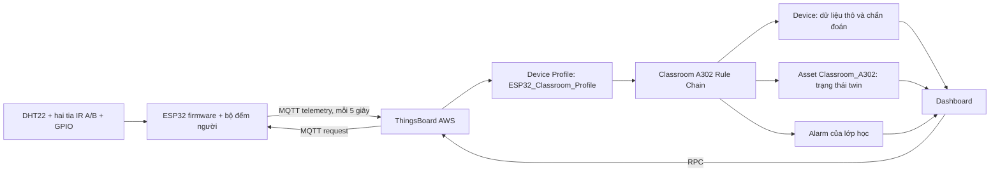

# Digital Twin lớp học A302

## Mạch và các kênh

| Thành phần | GPIO | Chân ESP32 trong Wokwi | Telemetry | Lệnh |
|---|---:|---|---|---|
| DHT22 | 15 | `D15` | `temperature`, `humidity`, `sensor_valid` | Đọc định kỳ |
| Tia IR A · ngoài cửa | 13 | `D13` | `ir_a_blocked` | Đầu vào đếm người, active LOW |
| Tia IR B · trong cửa | 27 | `D27` | `ir_b_blocked` | Đầu vào đếm người, active LOW |
| Dải 1 · gần bảng | 16 | `RX2` | `light1_state` | `setLight1`, `getLight1` |
| Dải 2 · nửa trước | 17 | `TX2` | `light2_state` | `setLight2`, `getLight2` |
| Dải 3 · nửa sau | 18 | `D18` | `light3_state` | `setLight3`, `getLight3` |
| Dải 4 · cuối lớp | 19 | `D19` | `light4_state` | `setLight4`, `getLight4` |
| LED xanh báo quạt | 23 | `D23` | `fan_state`, `fan_mode` | `setFan`, `setFanMode`, `getFan` |

Từ 15/10/2026, Wokwi không dùng module relay đỏ. Đầu ra quạt là GPIO23 →
điện trở 220Ω → anode LED xanh; cathode nối GND. Bốn LED vàng cũng có
điện trở 220Ω riêng, các cathode nối chung về GND. Chân `NC` của DHT22
để trống là đúng, không phải thiếu dây.

`fan_state` phản ánh GPIO, chưa đo tốc độ quay của quạt thật. PIR đã được
thay bằng hai tia A/B để xác định chiều đi. Quạt thật cần MOSFET/driver phù hợp,
không được nối động cơ trực tiếp vào GPIO.

Tên chân RX2/TX2 được đối chiếu với [định nghĩa board chính thức của Wokwi](https://github.com/wokwi/wokwi-boards/blob/main/boards/esp32-devkit-v1/board.json).
Bài test RPC/GPIO không tự chứng minh LED có dòng điện: cần kiểm tra cả
sơ đồ nối dây và quan sát LED. `tests/wiring_test.py` kiểm tra các mạch kín
và được chạy tự động trước khi build; Wokwi CLI lint kiểm tra pin hợp lệ.

## Ảnh và 4 dải chiếu sáng

`assets/classroom-overview-v2.png` là ảnh đã duyệt, nhìn từ góc cuối lớp trên
cao, bỏ tường bên phải và các viền tường thấp; nền ngoài lớp trong suốt.
Giữ bản cũ để đối chiếu, không dùng ảnh cũ trong dashboard hiện tại.

Đánh số 1–4 từ phía bảng đến cuối lớp. Mỗi kênh là một **dải ngang chạy
từ tường trái sang tường phải**, cả bốn dải song song, không phải vùng sáng
ở 4 góc hay dải dọc lớp. Hình học tại
`thingsboard/widgets/lighting-layout.json` phiên bản 4 dùng `projectionQuad`
để xác định ba đường ranh ngang theo phối cảnh, tại `v=0.25/0.50/0.75`.
Mỗi ranh được kéo dài qua toàn bộ ảnh, không giới hạn trong sàn/mặt bàn.
Dải 1 bao gồm toàn bộ bảng và tường trước; dải 4 kéo tới hết cuối lớp.
Bốn dải liền nhau phủ kín cả bàn, sàn và tường (`coverage: full-scene`).

Widget ghép các dải đang bật thành **một SVG path chung rồi làm mềm mép**,
hiển thị bằng một lớp ảnh sáng. Không chồng bốn lớp ảnh có alpha riêng,
vì cách đó có thể tạo đường tối tại chỗ tiếp giáp. Khi bật cả bốn, mask
phủ 100% cảnh ở cùng mức sáng; các bóng đổ vốn có trong ảnh vẫn tự nhiên.
Khi chỉ bật một đèn, vùng còn lại tối hơn, có phản sáng nền nhẹ.
Mặt nạ dùng tọa độ tương đối nên không bị lệch khi thay kích thước dashboard.

`setup.py` đưa ảnh và cấu hình này vào settings của dashboard trên AWS.
Đây là minh họa trạng thái ánh sáng, không phải mô phỏng quang học/lux thực.
Giữ nguyên firmware, GPIO và tên RPC; chỉ nhãn và cách trình bày thay đổi.

## Luồng dữ liệu

Raw telemetry đi lên topic `v1/devices/me/telemetry`. Firmware subscribe
`v1/devices/me/rpc/request/+` và trả lời tại
`v1/devices/me/rpc/response/{requestId}`.

## Quạt tự động và thủ công

- AUTO: số người >0 bật quạt; giữ 15 giây sau người cuối ra rồi tắt.
- MANUAL: dashboard điều khiển bằng `setFan(true/false)`. Lệnh này tự chuyển
  chế độ sang MANUAL.
- `setFanMode("AUTO")` đưa quyền điều khiển trở lại số người trong phòng.

Thuật toán đếm nằm tại `firmware/people-counter.h`, chạy trong task lấy mẫu
riêng trên ESP32, không dừng lấy mẫu trong lúc MQTT kết nối lại. Chỉ đếm khi
hoàn tất `thông → A → AB → B → thông` (vào), hoặc chuỗi ngược lại (ra).
Có debounce 30 ms, giới hạn chuỗi 8 giây, không đếm quay đầu, không cho số
người âm và đánh dấu cần hiệu chuẩn khi chuỗi không rõ hoặc có người ra
khi số đếm đang bằng 0. Snapshot lưu NVS khi có sự kiện; firmware không
coi reboot là phòng trống. Chi tiết tại [đếm người A/B](people-counter.md).

Firmware gửi telemetry ngay sau lệnh RPC và khi đầu ra quạt tự động thay đổi.
Lệnh điều khiển của dashboard chờ phản hồi ESP32; vùng sáng chỉ đổi khi nhận
telemetry. Nếu request timeout, giao diện không giả định đèn đã bật.

## Sức khỏe và Alarm xử lý ở đâu?

`thingsboard/rule-scripts/process-telemetry.js` chạy trong JavaScript node
**Compute classroom health and state** của Rule Chain trên ThingsBoard AWS.
File source local được `setup.py` nạp vào cấu hình node qua REST API; sửa source
phải chạy lại setup để server nhận bản mới.

| Alarm | Điều kiện mặc định | Điểm |
|---|---|---:|
| HIGH_TEMPERATURE | >28°C / >32°C | 40 / 90 |
| LOW_TEMPERATURE | <18°C | 35 |
| WEAK_SIGNAL | RSSI ≤−85 / ≤−90 dBm | 30 / 80 |
| INVALID_SENSOR | 3 mẫu lỗi liên tiếp | 80 |
| ACTUATOR_MISMATCH | Phản hồi lệch lệnh, sau 10 giây chờ và 3 mẫu | 70 |
| CONNECTION_LOST | Không nhận activity trong 20 giây | 100 |

Ngưỡng trên là cấu hình demo của lớp học, lưu ở server attributes trên Device.
Khi có nhiều lỗi, chọn lỗi có điểm cao nhất làm Alarm chính và lưu danh sách
đầy đủ trong `active_anomalies`. `health_score = max(0, 100 - anomaly_score)`.

Máy trạng thái: NORMAL → WARNING/ANOMALY → RECOVERY → NORMAL. Khi mất liên lạc,
twin chuyển OFFLINE; khi kết nối lại, cần 3 mẫu sạch để trở về NORMAL.

Dashboard ghi `expected_light1_state` đến `expected_light4_state` hoặc
`expected_fan_state` và timestamp bằng REST đã xác thực trước khi gửi RPC.
`capture-command.js` cũng hỗ trợ lệnh được đưa qua Rule Chain. Timestamp 0
chỉ là mặc định, không được coi là đã có lệnh thật. AUTO bỏ qua trạng thái
quạt mong muốn từ lệnh thủ công, vì quạt đang do số người điều khiển.

## Vì sao đây là Digital Twin?

Asset `Classroom_A302` đại diện cho lớp học; Device `ESP32_Classroom_Node` là
node cảm biến/chấp hành. Relation Contains và 7 Entity View biểu diễn các
thành phần: môi trường, bộ đếm người, quạt và 4 vùng đèn. View PIR cũ được
đổi thành PeopleCounter tại chỗ, không xóa Device/lịch sử dự án cũ.

Twin đồng bộ trạng thái quan sát từ telemetry, giữ lịch sử và điểm sức khỏe,
phát hiện bất thường, lưu trạng thái đầu ra mong muốn và gửi lệnh ngược xuống
ESP32. Vòng command → GPIO → telemetry → so sánh tạo phản hồi hai chiều. Ảnh
lớp học là cách trình bày; mô hình Asset/Device và vòng phản hồi mới là phần
Digital Twin của dự án.

## Docker

Trên EC2 hiện tại, PostgreSQL và ThingsBoard đang chạy bằng Docker của stack
có sẵn. Container bootstrap lớp học chỉ chạy khi triển khai để tạo tenant,
Rule Chain, Device, Asset, widget và dashboard, sau đó kết thúc.

`deployment/docker-compose.yml` là phương án dựng một server riêng từ đầu.
`deployment/docker-compose.bootstrap.yml` thêm lớp học vào ThingsBoard đang
chạy trên cùng Linux host. Database/volume lưu cấu hình và lịch sử; source
project nằm tại `/opt/classroom-digital-twin`.

